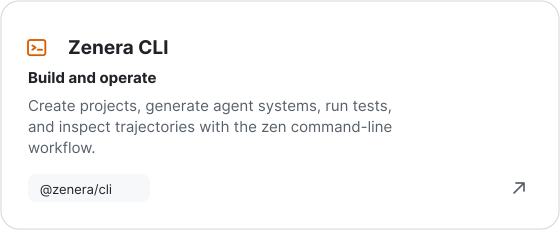
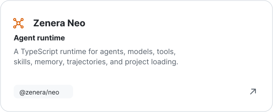
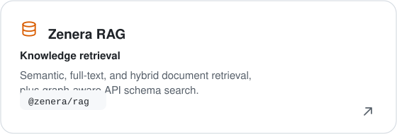
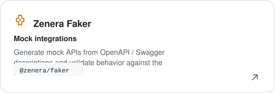

### Making specialized AI agents practical for real work.

Zenera is an AI company building toward a more useful way to create agent
systems: start with the work to be done, the knowledge it depends on, and the
constraints people need it to respect. Our focus is on agents that are
specialized, grounded in context, and designed to improve over time.

[**About Zenera**](https://zenera.ai) · [**LinkedIn**](https://www.linkedin.com/company/zenera-ai) · [**YouTube**](https://www.youtube.com/@Zenera_AI)

---

## Our work

We explore this approach through **ZeneraNeo**, an open-source experimental
project for building specialized agent systems from a specification and the
knowledge a task depends on. It helps developers design, run, inspect, and
improve agents for real workflows.

ZeneraNeo is a side project for experimentation; it is **not** the official
Zenera AI Platform. The project is one way we share ideas and learn in the open
as we work toward making agent systems more useful and dependable.

### ZeneraNeo packages

The project brings together four packages for creating and running agent
projects:

  <a href="https://www.npmjs.com/package/@zenera/cli">
    <picture>
      <source
        media="(prefers-color-scheme: dark)"
        srcset="./assets/card-cli-dark.svg"
      />
      <source
        media="(prefers-color-scheme: light)"
        srcset="./assets/card-cli-light.svg"
      />
      
    </picture>
  </a>
  <a href="https://www.npmjs.com/package/@zenera/neo">
    <picture>
      <source
        media="(prefers-color-scheme: dark)"
        srcset="./assets/card-neo-dark.svg"
      />
      <source
        media="(prefers-color-scheme: light)"
        srcset="./assets/card-neo-light.svg"
      />
      
    </picture>
  </a>
  <a href="https://www.npmjs.com/package/@zenera/rag">
    <picture>
      <source
        media="(prefers-color-scheme: dark)"
        srcset="./assets/card-rag-dark.svg"
      />
      <source
        media="(prefers-color-scheme: light)"
        srcset="./assets/card-rag-light.svg"
      />
      
    </picture>
  </a>
  <a href="https://www.npmjs.com/package/@zenera/faker">
    <picture>
      <source
        media="(prefers-color-scheme: dark)"
        srcset="./assets/card-faker-dark.svg"
      />
      <source
        media="(prefers-color-scheme: light)"
        srcset="./assets/card-faker-light.svg"
      />
      
    </picture>
  </a>

## How we approach agent systems

We believe people should be able to describe the work and its constraints
without having to hand-design every agent, prompt, tool, and handoff. In
ZeneraNeo, that idea becomes an iterative cycle: specify the job, generate an
agent system, inspect how it performs, and use what you learn to improve it.

## Examples

| Example | What it does |
| :--- | :--- |
| [Documentation RAG](https://github.com/andreyryabov/ZeneraNeo/tree/main/examples/projects/01-docs-rag) | Answers questions about Hugging Face Transformers documentation and cites the source passages. |
| [API Integration](https://github.com/andreyryabov/ZeneraNeo/tree/main/examples/projects/02-api-integration) | Coordinates a meeting using mock mail and calendar APIs, with confirmation required before writes. |

Explore [ZeneraNeo on GitHub](https://github.com/zenera-ai/ZeneraNeo) and browse
the [worked examples](https://github.com/andreyryabov/ZeneraNeo/tree/main/examples)
to see the project in action.

---

### Follow Zenera

**[Website](https://zenera.ai)** · **[ZeneraNeo on GitHub](https://github.com/zenera-ai/ZeneraNeo)** · **[LinkedIn](https://www.linkedin.com/company/zenera-ai)** · **[YouTube](https://www.youtube.com/@Zenera_AI)**

Zenera builds toward a future where specialized AI agents can do useful work with the right context and oversight.

