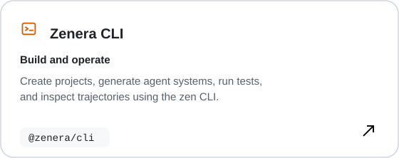
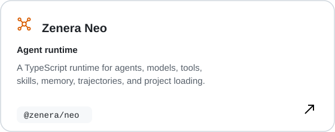
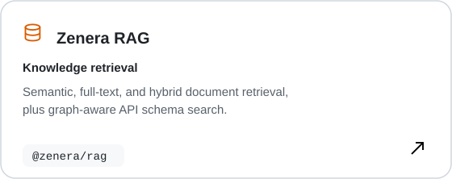
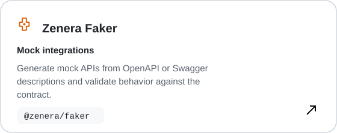
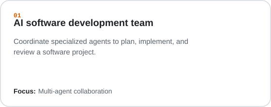
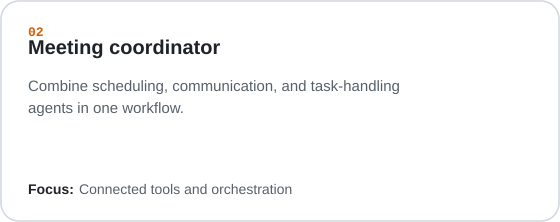
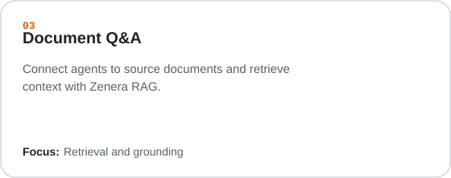
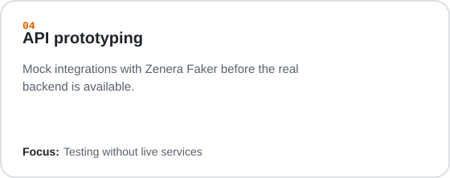

<div align="center">


### Build specialized AI agents from a specification.

Design, run, test, and improve agent systems with the Zenera developer toolkit.

[**Website**](https://zenera.ai) · [**Explore Neo**](https://github.com/zenera-ai/ZeneraNeo) · [**NPM**](https://www.npmjs.com/package/@zenera/cli)

</div>

---

## Get started

Install the toolkit globally:

```bash
npm install -g @zenera/cli @zenera/neo @zenera/rag @zenera/faker
```

Explore available commands:

```bash
zen --help
```

> [!TIP]
> New to building agent systems? Start with the [Zenera Neo repository](https://github.com/zenera-ai/ZeneraNeo) for project structure, examples, and setup guidance.

## Meet the toolkit

Four complementary packages take you from an initial specification to running agents and working integrations.

<p align="center">
  <a href="https://www.npmjs.com/package/@zenera/cli"></a>
  <a href="https://www.npmjs.com/package/@zenera/neo"></a>
</p>
<p align="center">
  <a href="https://www.npmjs.com/package/@zenera/rag"></a>
  <a href="https://www.npmjs.com/package/@zenera/faker"></a>
</p>

## From specification to running agents

<div align="center">


</div>

Start with a project specification. Use the meta-agent to create or update the implementation, run and inspect the result, then feed findings back into the spec. Repeat as the project evolves.

## What can you build?

Explore example systems that combine specialized agents, tools, and integrations.

<p align="center">
  
  
</p>
<p align="center">
  
  
</p>

Explore [Zenera Neo](https://github.com/zenera-ai/ZeneraNeo) for project structure, examples, and usage guidance.

---

<div align="center">

### Build with Zenera

**[Website](https://zenera.ai)** · **[Neo on GitHub](https://github.com/zenera-ai/ZeneraNeo)** · **[LinkedIn](https://www.linkedin.com/company/zenera-ai)** · **[YouTube](https://www.youtube.com/@Zenera_AI)**

<sub>Made for teams building intelligent agent systems.</sub>

</div>
